# REDLINE — Autonomous Vulnerability Remediation & Deterministic Verification Platform

> **AI proposes. The sandbox executes. Deterministic verification decides. Evidence explains why.**

REDLINE is an agentic software-remediation platform built for the **Nebius Global AI Hackathon**. It treats generative AI models as **strictly untrusted proposal generators**: candidate patches are executed inside isolated, ephemeral container sandboxes and evaluated exclusively through deterministic verification oracles and tamper-evident evidence receipts.

---

## 1. The Problem & REDLINE's Core Insight

### The Problem
Autonomous coding assistants are increasingly deployed to repair software defects and patch security vulnerabilities. However, existing agent architectures suffer from three critical architectural vulnerabilities:
1. **Self-Assessment Hallucination**: Asking a generative language model whether its own code patch is correct creates a circular trust loop. Models routinely hallucinate that incomplete, broken, or regression-inducing patches are "verified."
2. **Uncontrolled Host Execution**: Many coding assistants execute code directly on developer workstations or CI runners with unrestricted network access and ambient credentials, risking privilege escalation, data exfiltration, or remote code execution.
3. **Absence of Audit Evidence**: Code modifications are merged without tamper-evident proof that tests were genuinely executed in an authentic, isolated runtime.

### REDLINE's Core Insight
**Decouple patch generation from verification authority.**
- **Generative Models Propose**: LLMs generate structured architectural plans and unified diffs. They have **zero authority** over workflow state transitions or verification verdicts.
- **The Sandbox Executes**: Candidate patches are injected into an ephemeral Docker container configured with `--network none`, dropped Linux capabilities, clean environment (`environment={}`), and non-root execution.
- **Deterministic Verification Decides**: The verification verdict (`VERIFIED`, `REJECTED`, or `INCONCLUSIVE`) is determined solely by test suite exit codes and deterministic contract oracles.
- **Evidence Receipts Explain**: Every run produces an integrity-checked, tamper-evident `EvidenceReceipt` hashed via domain-separated SHA-256 canonicalization.

---

## 2. What Makes REDLINE Different

| Dimension | Standard AI Coding Assistant | REDLINE Platform |
| :--- | :--- | :--- |
| **Verification Authority** | LLM self-evaluates or runs ad-hoc commands | **Deterministic verification policy alone decides verdicts** |
| **Model Trust Level** | Model trusted to declare task completion | **Model strictly untrusted; proposals validated by schema gates** |
| **Sandbox Isolation** | Host shell or unconstrained container | **Docker container with `--network none`, `--cap-drop=ALL`, and read-only root** |
| **Credential Propagation** | Ambient credentials passed to shell | **Clean environment (`environment={}`); zero credential propagation** |
| **Audit Trail** | Unstructured text chat logs | **Tamper-evident `EvidenceReceipt` with SHA-256 canonicalization** |
| **Judge Agent Role** | Generative model acts as final arbiter | **Subordinate advisory explainer; cannot alter or upgrade verdicts** |

---

## 3. Architecture & Workflow

The diagram below illustrates the strict separation between untrusted generative stages and the authoritative deterministic verification gate:

```mermaid
flowchart TD
    subgraph Untrusted["UNTRUSTED GENERATION TIER"]
        TC[Task Contract & Scope] --> Architect[Architect Agent]
        Architect -->|ArchitectPlan| SchemaGate{Schema Gate<br/>extra=forbid}
        SchemaGate -->|Valid Plan| Builder[Builder Agent]
        Builder -->|PatchCandidate| ScopeGate{Scope Gate<br/>allowed_scope}
    end

    subgraph Sandbox["EPHEMERAL SECURE SANDBOX"]
        ScopeGate -->|Valid Patch| DockerRunner["Docker Runner<br/>(redline-sandbox-runner:latest)<br/>--network none | --cap-drop ALL<br/>--read-only | UID 1000:1000"]
        DockerRunner --> ExecTest["Execute Test Suite<br/>(python test_main.py)"]
    end

    subgraph Verification["DETERMINISTIC VERIFICATION TIER"]
        ExecTest --> Obs["Structured Observation<br/>(Exit Code, Stdout, Stderr)"]
        Obs --> Oracles["Contract Oracles &<br/>Red Team Invariant Checks"]
        Oracles --> DetGate{"Deterministic Policy Gate<br/>(Authoritative Sole Authority)"}
        DetGate -->|Exit 0 & Oracles Pass| Verified[VERIFIED]
        DetGate -->|Exit Non-Zero| Rejected[REJECTED / REPAIR]
        DetGate -->|Operational Error| Inconclusive[INCONCLUSIVE]
    end

    subgraph Evidence["TAMPER-EVIDENT EVIDENCE TIER"]
        Verified --> ReceiptBuilder[Evidence Receipt Builder]
        ReceiptBuilder --> Receipt["EvidenceReceipt<br/>(Domain-Separated SHA-256 Digest)"]
        Receipt --> Judge[Judge Agent<br/>Advisory Plain-Text Summary]
    end

    classDef untrusted fill:#2d1515,stroke:#ff6b6b,stroke-width:1px;
    classDef sandbox fill:#1a233a,stroke:#4dabf7,stroke-width:1px;
    classDef verifier fill:#1b2e1b,stroke:#51cf66,stroke-width:1px;
    classDef evidence fill:#2b1d3a,stroke:#cc5de8,stroke-width:1px;

    class TC,Architect,Builder,SchemaGate,ScopeGate untrusted;
    class DockerRunner,ExecTest sandbox;
    class Obs,Oracles,DetGate,Verified,Rejected,Inconclusive verifier;
    class ReceiptBuilder,Receipt,Judge evidence;
```



---

## 4. Key Features & Verified Trust Boundaries

### 1. Model Trust Boundary
- `ArchitectAgent` generates structured remediation plans adhering strictly to Pydantic schemas with `extra="forbid"`. Extraneous keys or malformed JSON immediately fail closed to `OperationalResult.MODEL_FAILURE`.
- `BuilderAgent` produces minimal unified diffs confined to the pre-authorized `allowed_scope` file list. Out-of-scope diffs are rejected before execution.
- Generative models never control state transitions. The canonical `Orchestrator` state machine transitions solely on deterministic events.

### 2. Ephemeral Sandbox Boundary
Candidate code executes inside `redline-sandbox-runner:latest` (built on pinned `python:3.11-slim-bookworm`):
- **Non-Root Execution**: Runs strictly as unprivileged user `UID 1000:GID 1000`.
- **Network Isolation**: Strict `--network none`; candidate containers have zero outbound or inbound network access.
- **Privilege Confinement**: Dropped Linux capabilities (`--cap-drop=ALL`) and `--security-opt=no-new-privileges`.
- **Filesystem Segregation**: Read-only container root filesystem (`--read-only`); in-memory volatile scratch space (`--tmpfs /tmp:rw,noexec,nosuid,size=64m`); workspace bind-mount restricted to an ephemeral copy of the repository.
- **Credential Stripping**: Container execution requests pass `environment={}`, preventing host API keys and tokens from entering the container environment.

### 3. Deterministic Verification Gate
- The verification verdict is governed by `backend/orchestrator/orchestrator.py` evaluating test suite exit codes (`exit_code == 0`) and contract oracles.
- The `JudgeAgent` provides an advisory natural-language explanation (`confidence: HIGH`), but its claims are verified against the receipt (`_verify_explanation_consistency`). Judge failure does not alter or upgrade the verdict.

### 4. Tamper-Evident Evidence Receipts
- Receipts record execution IDs, repository snapshot hashes, patch diff hashes, test result summaries, and sandbox provenance.
- Integrity is computed via domain-separated SHA-256 canonicalization:
  ```text
  SHA-256("REDLINE_EVIDENCE_RECEIPT_V1:" + CanonicalJSON(receipt_without_hash))
  ```
- Any manual modification of execution records or test counts invalidates `verify_receipt_integrity(receipt)`.

---

## 5. Actual Execution Walkthrough with a Real Demonstrated Task

In end-to-end integration testing, REDLINE resolved a real defect on disposable fixture `data/fixtures/repo-cons-1`:

### 1. Defect & Acceptance Criteria
- **Target File**: `data/fixtures/repo-cons-1/main.py`
- **Initial Content**: `'old'`
- **Failing Test**: `test_main.py` verifies that `main.py` has been patched. When unpatched, it exits 1 with:
  `AssertionError: main.py has not been patched`
- **Acceptance Criteria**: `test_main.py` exits with code 0 and prints `'1 passed'`.

### 2. Live Model Invocation (Nebius Token Factory)
- **Model**: `nvidia/Nemotron-3_5-Lightning`
- **Architect Response**: Successfully generated an `ArchitectPlan` with objective, target files (`['main.py']`), constraints, and acceptance criteria.
- **Builder Response**: Synthesized unified diff patch `PATCH-CDEDE8A6`:
  ```diff
  --- a/main.py
  +++ b/main.py
  @@ -1 +1 @@
  -old
  +def calculate():
  +    pass
  ```

### 3. Sandbox Test Execution
- Container launched with image `redline-sandbox-runner:latest` under `--network none`.
- Test command: `python test_main.py`
- **Observed Result**: Exit Code 0, runtime 760 ms, stdout: `"1 passed"`.

### 4. Deterministic Verification & Evidence Receipt
- The deterministic verification policy confirmed exit code 0.
- An `EvidenceReceipt` was sealed with hash:
  `98e1db5957ea1cf5327a3f73cf514115f9bd04ec92d72a51e72e6765c6a0489c`
- Advisory Judge generated factual commentary:
  > *"Execution completed with exit code 0 under enforced sandbox isolation. Four tests were executed with 1 passed and 0 failures. The verification verdict is VERIFIED."*
- Orchestrator reached final terminal state: **`VERIFIED`**.

---

## 6. Evidence Receipt & Verdict Explanation

### Anatomy of an Evidence Receipt
Every REDLINE execution produces an immutable `EvidenceReceipt` containing:
- **Execution Identity**: `run_id`, `task_id`, and ISO-8601 timestamp.
- **Provenance Hashes**: SHA-256 hashes of repository snapshot, task contract, and unified patch diff.
- **Test Results**: Structured observations, exit codes, passed/failed test counts, and execution durations.
- **Security & Invariant Observations**: Red team invariant evaluations, security scanner checks, and counterexamples.
- **Environment Provenance**: Docker image ID, container engine metadata, and model attribution (`nvidia/Nemotron-3_5-Lightning`).
- **Cryptographic Digest**: The `receipt_hash` computed over all canonical receipt fields.

### Canonicalization Algorithm
Receipt hashing enforces deterministic formatting before hashing:
```python
data = receipt.model_dump(exclude={"receipt_hash", "timestamp"}, mode="json")
canonical_json = json.dumps(data, sort_keys=True, separators=(',', ':'))
domain_separated = f"REDLINE_EVIDENCE_RECEIPT_V1:{canonical_json}"
digest = hashlib.sha256(domain_separated.encode("utf-8")).hexdigest()
```

### Cryptographic Trust Boundary: What the Receipt Proves vs. What It Does Not Prove
- **What It Proves**:
  - The receipt content has not been tampered with or altered post-execution.
  - The recorded test results match the exact output produced inside the container.
  - The patch hash precisely corresponds to the code executed in the sandbox.
- **What It Does Not Prove**:
  - The receipt uses symmetric SHA-256 canonical hashing, **not** an asymmetric public-key digital signature (e.g., Ed25519). It proves content integrity, not cryptographic signer non-repudiation.
  - Passing a test suite proves adherence to the executed test specifications; it does not guarantee that the test suite was exhaustive or that zero latent vulnerabilities remain.

---

## 7. Screenshots & User Interface

REDLINE includes a Next.js 16 + React 19 web dashboard for monitoring remediation runs and auditing evidence receipts:

| Dashboard View | Description |
| :--- | :--- |
| **Mission Control & Session Detail**<br/>`Degine.md/stitch_poject_redline/session_detail_mission_control/screen.png` | Live run tracking displaying Orchestrator state transitions, active patch candidates, and verification logs. |
| **Evidence & Cryptographic Receipts**<br/>`Degine.md/stitch_poject_redline/evidence_cryptographic_receipts/screen.png` | Deep inspection view for sealed `EvidenceReceipt` records, SHA-256 canonical digests, and test summaries. |
| **Sandbox Deep Dive**<br/>`Degine.md/stitch_poject_redline/playground_sandbox_deep_dive/screen.png` | Ephemeral container inspection showing `--network none` isolation, non-root execution, and resource limits. |
| **Dashboard Overview**<br/>`Degine.md/stitch_poject_redline/dashboard_overview/screen.png` | System-wide overview of completed remediation runs, verified patches, and held-out benchmark anchors. |

---

## 8. Technology Stack

- **Inference Provider**: Nebius Token Factory (`https://api.tokenfactory.nebius.com/v1/chat/completions`)
- **Foundation Model**: `nvidia/Nemotron-3_5-Lightning` (NVIDIA open-source foundation model)
- **Backend Core**: Python 3.11+, FastAPI, Pydantic v2, pytest, uvicorn
- **Frontend Dashboard**: Next.js 16 (App Router), React 19, TypeScript, Tailwind CSS v4, anime.js
- **Sandbox Infrastructure**: Docker Desktop (WSL2 Linux) / native Linux OCI container daemon
- **Benchmark Anchor Engine**: Cryptographic Git commit anchoring (`benchmark-v1.0.0`) with SHA-256 manifest verification

---

## 9. Prerequisites

Before running REDLINE, ensure your system has:
1. **Python**: Version 3.11 or 3.12 installed with `pip` and `venv`.
2. **Node.js**: Version 20+ with `npm`.
3. **Docker**: Docker Desktop (Windows with WSL2) or Docker Engine (Linux) running.
4. **Git**: Installed and available on your system `PATH`.
5. **Nebius API Key** *(Optional for offline mock demo; required for live model inference)*: Active API token from Nebius Token Factory.

---

## 10. Quickstart Instructions

### Option A: Windows (PowerShell)

1. **Clone and navigate to repository root**:
   ```powershell
   git clone https://github.com/your-org/REDLINE.git p:\REDLINE
   Set-Location p:\REDLINE
   ```

2. **Configure environment**:
   ```powershell
   Copy-Item .env.example .env
   # Edit .env to add your NEBIUS_API_KEY if testing live inference
   ```

3. **Verify Python virtual environment**:
   ```powershell
   # Use existing project venv or initialize one
   .\venv\Scripts\python.exe -m pip install -r requirements.txt
   ```

4. **Verify Docker daemon and build sandbox image**:
   ```powershell
   docker info
   docker build -t redline-sandbox-runner:latest -f deploy/sandbox/Dockerfile deploy/sandbox/
   ```

5. **Start the Backend API Server**:
   ```powershell
   .\venv\Scripts\python.exe -m uvicorn backend.api.app:app --host 127.0.0.1 --port 8000
   ```
   API docs will be available at `http://127.0.0.1:8000/docs`.

6. **Start the Frontend Dashboard** (in a separate terminal):
   ```powershell
   Set-Location p:\REDLINE\frontend
   npm install
   npm run dev
   ```
   Dashboard will be available at `http://localhost:3000`.

---

### Option B: Linux / macOS (Bash)

1. **Clone and navigate to repository root**:
   ```bash
   git clone https://github.com/your-org/REDLINE.git redline
   cd redline
   ```

2. **Configure environment**:
   ```bash
   cp .env.example .env
   ```

3. **Initialize virtual environment**:
   ```bash
   python3 -m venv venv
   source venv/bin/activate
   pip install -r requirements.txt
   ```

4. **Build sandbox container image**:
   ```bash
   docker build -t redline-sandbox-runner:latest -f deploy/sandbox/Dockerfile deploy/sandbox/
   ```

5. **Start Backend & Frontend**:
   ```bash
   # Terminal 1: Backend
   python3 -m uvicorn backend.api.app:app --host 127.0.0.1 --port 8000

   # Terminal 2: Frontend
   cd frontend && npm install && npm run dev
   ```

---

## 11. Demonstration Commands & Expected Outcomes

REDLINE includes three distinct execution modes for evaluation:

### 1. Fast Deterministic Mock Rehearsal (~10 seconds)
Runs the complete Orchestrator workflow, sandbox container, and receipt generator offline without calling external APIs:
```powershell
.\venv\Scripts\python.exe scratch/demo_rehearsal.py
```
**Expected Outcome**:
- Model Attribution: `Deterministic Rehearsal Engine (deterministic-demo-engine-v1)`
- Sandbox: Executes `redline-sandbox-runner:latest` with `--network none`
- Test Output: `1 passed`, Exit Code 0
- Final State: `VERIFIED`
- Cryptographic Receipt: `VALID` (SHA-256 verified)

### 2. Live Nebius / NVIDIA Model Run (~45 seconds)
Dispatches genuine outbound inference to Nebius Token Factory using `nvidia/Nemotron-3_5-Lightning`:
```powershell
.\venv\Scripts\python.exe scratch/demo_rehearsal.py --live
```
**Expected Outcome**:
- Model Attribution: `Nebius Token Factory (nvidia/Nemotron-3_5-Lightning)`
- Architect Plan: Parsed and validated through schema gate
- Builder Patch: Synthesized and accepted
- Test Output: `1 passed` inside Docker container
- Final State: `VERIFIED`
- Cryptographic Receipt: `VALID`

### 3. Stage 15 Multi-Scenario Suite (~30 seconds)
Executes 5 canonical scenarios verifying clean fix, autonomous repair, rejection, policy blocking, and tampered evidence detection:
```powershell
.\venv\Scripts\python.exe -m backend.demo.run_demo all
```

---

## 12. Three-Minute Presentation Demo Script

| Timecode | Step | Screen / Action | Spoken Narration |
| :--- | :--- | :--- | :--- |
| **0:00 – 0:30** | **The Problem** | Show `data/fixtures/repo-cons-1/main.py` failing `test_main.py` | *"Autonomous AI coding agents often hallucinate broken code and cannot be trusted to evaluate themselves. REDLINE solves this: generative models are untrusted, sandbox isolation is strictly enforced, and deterministic tests alone govern verification."* |
| **0:30 – 1:15** | **Live Generation** | Launch `demo_rehearsal.py --live` in terminal | *"We trigger an automated remediation. REDLINE calls Nebius Token Factory using NVIDIA Nemotron 3.5 Lightning. The Architect agent produces a schema-validated plan, and the Builder synthesizes a scoped patch."* |
| **1:15 – 2:00** | **Sandbox Isolation** | Observe Docker container launch | *"The patch enters an ephemeral Docker sandbox running `redline-sandbox-runner:latest`. Notice the isolation: `--network none`, stripped credentials, and read-only host mounts. The test runs inside the container and outputs '1 passed' with exit code 0."* |
| **2:00 – 2:35** | **Deterministic Verdict** | Terminal displays receipt and verdict | *"The deterministic verification policy validates test results and signs an Evidence Receipt with SHA-256 integrity. The advisory Judge explains the result, but cannot alter the verdict."* |
| **2:35 – 3:00** | **The Distinction** | Show Evidence Receipt hash & web UI | *"REDLINE turns AI coding from an uncontrolled risk into an auditable, verifiable engineering pipeline powered by Nebius and NVIDIA open-source intelligence."* |

---

## 13. Backup Demonstration Procedure

If live external API access to Nebius Token Factory or Docker Desktop encounters transient issues during presentation:

1. **Option A (Offline Deterministic Runner)**:
   - Run: `.\venv\Scripts\python.exe scratch/demo_rehearsal.py`
   - *Disclosure*: *"This fallback demonstrates the genuine Orchestrator state machine, real Docker sandbox container, and cryptographic receipt generator using deterministic test responses."*
2. **Option B (Pre-Recorded Evidence Logs)**:
   - Inspect stored live logs and receipt digests from validated runs:
     - Log: `.system_generated/tasks/task-1653.log`
     - Receipt Data: `scratch/live_e2e_results.json`
     - Audit Report: `docs/stage_2_9_6_5_final_integration_and_demo_readiness_report.md`
   - *Disclosure*: *"These logs represent an authentic live run executed against Nebius Token Factory during submission validation."*

---

## 14. Configuration Reference

All settings are controlled via the local gitignored `.env` file:

| Variable | Default Value | Description |
| :--- | :--- | :--- |
| `REDLINE_MODEL_PROVIDER` | `nebius` | Model provider selector (`nebius`, `freellmapi`, or `deterministic`). |
| `NEBIUS_API_KEY` | *(None)* | Bearer API token for Nebius Token Factory. |
| `NEBIUS_BASE_URL` | `https://api.tokenfactory.nebius.com/v1` | Base URL for Nebius Token Factory API. Outbound inference appends `/chat/completions`. |
| `NEBIUS_MODEL` | `nvidia/Nemotron-3_5-Lightning` | Active foundation model. Must be an active model ID in Nebius catalog. |
| `NEBIUS_MAX_RESPONSE_BYTES` | `1048576` (1 MiB) | Maximum payload size accepted from provider to prevent memory exhaustion. |
| `FREELLMAPI_API_KEY` | *(None)* | Local unified bearer token for FreeLLMAPI gateway. |
| `FREELLMAPI_BASE_URL` | `http://127.0.0.1:3001/v1` | Local OpenAI-compatible gateway base URL. |
| `FREELLMAPI_MODEL` | `auto` | FreeLLMAPI model identifier (e.g. `auto`, `llama-3.3-70b`). |
| `FREELLMAPI_MAX_RESPONSE_BYTES` | `1048576` (1 MiB) | Maximum payload size accepted from local gateway. |
| `NEXT_PUBLIC_API_BASE_URL` | `http://127.0.0.1:8000/api/v1` | Backend API URL used by the frontend dashboard. |

### Optional Secondary Provider: FreeLLMAPI
REDLINE supports [FreeLLMAPI](https://github.com/tashfeenahmed/freellmapi.git) as an optional, self-hosted secondary LLM provider. Nebius Token Factory remains the default primary provider.

1. **Install and Run FreeLLMAPI**:
   Following official instructions:
   ```bash
   # One-liner install with Docker:
   curl -fsSL https://freellmapi.co/install.sh | bash
   # Or via Docker Compose:
   git clone https://github.com/tashfeenahmed/freellmapi.git && cd freellmapi && docker compose up -d
   ```
2. **Configure in `.env`**:
   ```env
   REDLINE_MODEL_PROVIDER=freellmapi
   FREELLMAPI_API_KEY=your-freellmapi-unified-key
   FREELLMAPI_BASE_URL=http://127.0.0.1:3001/v1
   FREELLMAPI_MODEL=auto
   ```
3. **Switch Back to Token Factory**:
   ```env
   REDLINE_MODEL_PROVIDER=nebius
   ```
4. **Run Provider Unit Tests**:
   ```powershell
   .\venv\Scripts\python.exe -m pytest tests/test_model_providers.py -k freellmapi
   ```
5. **Gateway Security & Limitations**:
   - The local gateway must remain strictly private (loopback destinations: `localhost` / `127.0.0.1` / `::1`, with `host.docker.internal` requiring explicit opt-in via `REDLINE_CONTAINERIZED=1` or `FREELLMAPI_APPROVED_HOSTS`); remote endpoints and unapproved ports are rejected by policy to prevent SSRF.
   - FreeLLMAPI is experimental and not production-grade; free-tier quotas, latency, and model availability depend entirely on upstream provider terms.

---

## 15. Security Model & Known Limitations

### Truthful Security Disclosures
1. **Reactive Disk Measurement**:
   - Workspace disk consumption is monitored reactively via post-execution filesystem checks rather than a hard Linux kernel quota block, due to Windows 11 / WSL2 overlayfs driver limitations.
2. **Memory Limit Enforcement**:
   - Docker container execution specifies memory constraints; hard OOM-killer behavior on Windows 11 depends on Docker Desktop's WSL2 kernel configuration.
3. **Receipt Integrity vs Digital Signatures**:
   - Evidence receipts are tamper-evident via domain-separated canonical SHA-256 digests (`verify_receipt_integrity`). They do not use asymmetric public-key cryptography (PKI) and should not be confused with digital signatures.
4. **Verification Bounds**:
   - Passing a test suite proves that the candidate patch satisfied the observed assertions under the evaluated inputs. It does not mathematically prove the absence of undiscovered vulnerabilities or universal program correctness.
5. **Model Reasoning Latency**:
   - `nvidia/Nemotron-3_5-Lightning` produces 1,200–1,800 internal thinking tokens before emitting output, taking approximately 9–13 seconds per call.

---

## 16. Testing & Reproducibility

All features are covered by comprehensive automated regression suites:

- **Backend Regression Suite**: **179 passed, 1 skipped, 0 failed** in 12.78s
  ```powershell
  .\venv\Scripts\python.exe -m pytest tests/test_architect_structured_output.py tests/test_judge_failure_diagnosis.py tests/test_model_providers.py tests/test_provider_cross_isolation.py tests/test_stage4.py tests/test_stage5.py tests/test_stage11.py tests/test_stage16_4_orchestrator_execution.py tests/test_secure_sandbox_backend.py tests/test_stage_2_9_9_security_remediation.py
  ```
  *(Note: 1 skipped test is `test_cgroups_memory_limit_enforced` due to Windows 11 WSL2 cgroups v2 controller configuration differences.)*
- **Frontend Acceptance Suite**: **111 passed, 0 failed** in 1.32s
  ```powershell
  cd frontend && npm test
  ```
- **Frozen Benchmark Anchor**: Verified commit `6e476bccaba2187055254d1cd71b539d7903b34f`, manifest SHA-256 `d2cd37b9a588151975c992426338b0341f39bc824e1627c32d51e02ed1ac20c2` (**84/84 artifacts verified**).

---

## 17. Troubleshooting Guidance

- **Docker daemon unreachable**: Verify Docker Desktop is active under the `desktop-linux` context by executing `docker info`.
- **PowerShell UTF-16 `.env` encoding**: REDLINE's `.env` loader automatically detects UTF-16, UTF-16-LE, and UTF-8 encodings.
- **Model Provider 404**: Ensure `NEBIUS_MODEL=nvidia/Nemotron-3_5-Lightning`. The older identifier `nvidia/Llama-3.1-Nemotron-70B-Instruct-HF` is not hosted on Nebius Token Factory.
- **Windows Read-Only `.git` Cleanup**: All temporary workspaces utilize `_rmtree_readonly` to clear Windows read-only bits before deletion, leaving zero residual folders.

---

## 18. Hackathon Attribution

- **Competition**: Nebius Global AI Hackathon
- **Inference Platform**: Nebius Token Factory (`https://api.tokenfactory.nebius.com/v1`)
- **Model Attribution**: `nvidia/Nemotron-3_5-Lightning` (NVIDIA Open-Source Foundation Model)
- **Submission Readiness**: Full working end-to-end implementation verified live.

---

## 19. Future Work & License

### Future Roadmap (Separate from Demonstrated Features)
The following capabilities represent architectural roadmaps beyond the hackathon submission:
- **Multi-Language Sandbox Images**: Pre-baked container images for Rust (Cargo), Go, and Node.js.
- **Asymmetric PKI Digital Signatures**: Ed25519 signing keys for enterprise non-repudiation of Evidence Receipts.
- **Continuous CI/CD Gate Agent**: GitHub Action and GitLab CI runner integrations for automated pull request gatekeeping.

### License & Contributions
REDLINE is developed as an open research and engineering prototype for the **Nebius Global AI Hackathon**. Contributions and pull requests follow standard GitHub development workflows.
