# REDLINE — STEP 2.9.5.1: End-to-End Demo Readiness Audit Report

**Date:** 2026-10-22  
**Target Event:** Nebius Global AI Hackathon  
**Target Repository:** REDLINE — Autonomous Software-Engineering Verification & Evidence Platform  
**Audit Scope:** End-to-End Demo Readiness Audit across Model Providers, Agent Orchestration, Sandbox Execution, Deterministic Verification, Persistence, Frontend Journey, and Test Health.

---

## 1. Executive Summary

REDLINE is designed under a frozen architectural thesis: **LLMs propose; policy controls; sandbox executes; deterministic systems measure; evidence proves; policy decides; Judge explains; frontend displays.**

This audit assessed whether the current codebase can deliver a genuine, demonstrable end-to-end agentic coding workflow for the Nebius Global AI Hackathon.

### Bottom-Line Assessment: **PARTIALLY DEMONSTRABLE — CRITICAL BLOCKER IN CODE EXECUTION LOOP**

1. **Deterministic Verification & Evidence Engine is Production-Grade:**
   The deterministic verification engine (`DeterministicVerificationPolicy`), Merkle-tree evidence receipt generator (`EvidenceAggregator`), SQLite WAL persistence layer (`SQLiteRunRepository`), and Next.js frontend are fully implemented, structurally hardened against tampering, and verified by 231 passing Python tests and 111 passing Frontend tests.

2. **The Single Highest-Priority Blocker:**
   In the canonical `Orchestrator` (`backend/orchestrator/orchestrator.py`), **`RunState.TEST` and `RunState.VERIFY` contain stubbed execution logic.**
   - In `RunState.TEST` (line 118): the orchestrator advances unconditionally on `TEST_SUCCESS` without applying the patch candidate or executing any unit tests.
   - In `RunState.VERIFY` (lines 66-68 of `backend/verification/attack_executor.py`): the attack executor runs a mock command `["python", "-c", "print('Executing ...')"]` in an empty temporary directory instead of applying the patch to the workspace and executing real test suites or adversarial security fixtures.
   - Although `SandboxClient.run_isolated` (`backend/sandbox/client.py`) contains real patch application (`git apply`) and isolated test execution, it was only wired into tests and was **never plugged into the canonical `Orchestrator`**.

3. **Nebius & NVIDIA Model Status:**
   - The HTTP adapter for Nebius Token Factory (`NebiusProvider` inheriting from `OpenAICompatibleProvider`) is implemented with base URL validation, strict hostname allowlisting (`api.tokenfactory.nebius.com`), 443 port policy, credential redaction, response byte limits (1 MB), and redirect suppression (`allow_redirects=False`).
   - However, **neither `NEBIUS_API_KEY` nor `NEBIUS_MODEL` is set in the environment or in `.env`**.
   - As a result, the backend currently falls back to `DeterministicTestProvider` (mock). Live model inference with NVIDIA open-source models (such as `nvidia/Llama-3.1-Nemotron-70B-Instruct-HF`) is ready in code but **untested live and currently blocked by missing credentials**.

4. **Sandbox Daemon Status:**
   - `SecureSandboxBackend` correctly enforces fail-closed isolation: if the container runtime daemon is unavailable, untrusted candidate execution is refused (`OPERATIONAL_FAILURE`) with zero host fallback.
   - On this host, the Docker CLI binary exists (`C:\Program Files\Docker\Docker\resources\bin\docker.EXE`), but the **Docker daemon is offline** (`docker info` timed out after 5s). For untrusted tasks without `REDLINE_ENABLE_LOCAL_BACKEND=1`, execution fails closed as required by policy.

5. **Frontend Status:**
   - The primary user journey on `/` (intake form -> background orchestrator execution -> polling -> visualizer -> verdict display -> evidence receipt -> diff view) and deep-links (`/results`, `/evidence`, `/sessions`) are functional and talk to real FastAPI endpoints.
   - However, peripheral pages (`/projects`, `/repositories`, `/models`, `/playground`) render static mock fixtures rather than querying dynamic backend persistence.

---

## 2. Feature-by-Feature Status Matrix

| Component / Capability | Status | Core File(s) & Function(s) | Notes |
| :--- | :--- | :--- | :--- |
| **Nebius Provider Adapter** | **PARTIAL** | `backend/models/nebius_provider.py`<br>`NebiusProvider.__init__`<br>`backend/models/openai_compatible_provider.py`<br>`OpenAICompatibleProvider.generate` | Implemented with strict URL validation, credential redaction, and response limits. Blocked by missing `NEBIUS_API_KEY`. |
| **NVIDIA Model Support** | **PARTIAL** | `backend/models/nebius_provider.py`<br>`backend/models/registry.py` | Token Factory endpoint supports NVIDIA Nemotron models. Relies on `NEBIUS_MODEL` env var. No live test performed. |
| **Provider Auto-Detection** | **VERIFIED** | `backend/models/registry.py`<br>`get_model_provider` | Prioritizes `REDLINE_MODEL_PROVIDER` -> `NEBIUS_API_KEY` -> `FREELLMAPI_API_KEY` -> `DeterministicTestProvider`. |
| **Architect Agent** | **VERIFIED** | `backend/agents/architect.py`<br>`ArchitectAgent.plan` | Generates validated `ArchitectPlan` JSON, enforces `allowed_scope` policy, records telemetry. |
| **Builder Agent** | **VERIFIED** | `backend/agents/builder.py`<br>`BuilderAgent.build` | Generates unified diff patch, enforces Pydantic bounds, rejects unexpected keys, tracks SHA-256. |
| **Red Team Agent** | **VERIFIED** | `backend/agents/red_team.py`<br>`RedTeamAgent.generate_attacks` | Hybrid deterministic + model attack generation, deduplication by fingerprint, budget ranking. |
| **Repairer Agent** | **VERIFIED** | `backend/agents/repairer.py`<br>`RepairerAgent.repair` | Consumes deterministic counterexamples, produces repair diffs, tracks parent patch lineage. |
| **Judge Agent** | **VERIFIED** | `backend/agents/judge.py`<br>`JudgeAgent.generate_explanation` | Advisory explanation generator. Claims validated against receipt IDs. Cannot override verdict. |
| **Canonical Orchestrator** | **PARTIAL** | `backend/orchestrator/orchestrator.py`<br>`Orchestrator.run`<br>`backend/orchestrator/transition_policy.py` | State machine transitions properly, but `TEST` and `VERIFY` are stubs that do not execute patched code. |
| **Secure Sandbox Backend** | **PARTIAL** | `backend/sandbox/secure_backend.py`<br>`SecureSandboxBackend.execute`<br>`ContainerRuntimeProbe.detect_runtime` | Hardened container arguments (`--cap-drop=ALL`, `--read-only`, `--network none`). Docker daemon offline on host. |
| **Fail-Closed Host Fallback Gate** | **VERIFIED** | `backend/sandbox/factory.py`<br>`get_sandbox_backend` | Untrusted workloads NEVER receive `LocalDevelopmentBackend`. Fails closed if container engine is absent. |
| **Patch Validation** | **VERIFIED** | `backend/verification/patch_validation.py`<br>`validate_patch` | Validates unified diff syntax, rejects path traversal (`../`), enforces file allowlist. |
| **Deterministic Verification Policy** | **VERIFIED** | `backend/verification/policy.py`<br>`DeterministicVerificationPolicy.evaluate` | Authoritative verdict assignment based on test observations, invariants, and regression tests. |
| **Evidence Receipt Generation** | **VERIFIED** | `backend/evidence/builder.py`<br>`EvidenceAggregator.build_receipt` | Computes SHA-256 Merkle root hash, binds patch lineage, produces immutable receipt. |
| **SQLite WAL Persistence** | **VERIFIED** | `backend/storage/database.py`<br>`backend/storage/repositories.py` | Durable SQLite storage for runs, patches, events, and receipts. WAL mode with thread-safety. |
| **Artifact File Storage** | **VERIFIED** | `backend/storage/artifacts.py`<br>`ArtifactStorage.store_artifact` | Content-addressed storage for diffs, receipts, and reports. Path traversal protected. |
| **Run Recovery on Boot** | **VERIFIED** | `backend/storage/repositories.py`<br>`SQLiteRunRepository.recover_interrupted_runs` | Automatically marks non-terminal runs as ABORTED upon application startup. |
| **REST API Gateway** | **VERIFIED** | `backend/api/routes/runs.py`<br>`create_run`, `get_run_status` | FastAPI endpoints for run lifecycle, diffs, receipts, judge explanations, and artifact downloads. |
| **Frontend User Journey** | **VERIFIED** | `frontend/src/app/page.tsx`<br>`frontend/src/components/RunCreationForm.tsx` | Interactive task intake, state polling with exponential backoff guards, verdict and diff viewers. |
| **Frontend Peripheral Views** | **PARTIAL** | `frontend/src/app/projects/page.tsx`<br>`frontend/src/app/repositories/page.tsx` | Pages display hardcoded static fixtures (`REGISTERED_PROJECTS`, `REPOSITORY_POLICIES`) instead of API data. |
| **Benchmark Runner Engine** | **VERIFIED** | `backend/benchmark/runner.py`<br>`backend/benchmark/evaluator.py` | 3-phase deterministic evaluation engine (public, vulnerability, secure invariant) with integrity gates. |

---

## 3. Supporting Evidence: Exact File Paths and Functions

### 3.1 Nebius and NVIDIA Integration
- **`backend/models/openai_compatible_provider.py`**
  - Line 28: `OpenAICompatibleProvider.__init__`: Sets default limits, timeout (60s), and byte ceiling (1MB default).
  - Line 62: `OpenAICompatibleProvider._validate_destination`: Rejects userinfo, raw integer/octal/hex IPs, non-HTTP/HTTPS schemes, and non-whitelisted hosts.
  - Line 183: `OpenAICompatibleProvider._redact_secrets`: Replaces API keys with `[REDACTED_API_KEY]` in all error messages.
  - Line 246: `OpenAICompatibleProvider.generate`: Passes `allow_redirects=False` to `requests.post`, explicitly preventing SSRF and redirect credential leakage.
- **`backend/models/nebius_provider.py`**
  - Line 26: `NebiusProvider.__init__`: Reads `NEBIUS_API_KEY`, `NEBIUS_BASE_URL` (default `https://api.tokenfactory.nebius.com/v1/`), `NEBIUS_MODEL`, and enforces `allowed_hostnames=["api.tokenfactory.nebius.com"]`, `allowed_ports=[443]`, `allowed_schemes=["https"]`.
- **`backend/models/registry.py`**
  - Line 34: `get_model_provider`: Unset provider auto-detection: checks `NEBIUS_API_KEY` -> `FREELLMAPI_API_KEY` -> falls back to `DeterministicTestProvider`.
  - Line 63: Explicit `REDLINE_MODEL_PROVIDER=nebius` without `NEBIUS_API_KEY` immediately raises `ModelProviderError(ModelErrorType.MODEL_CONFIGURATION_ERROR)`.

### 3.2 Agent Workflow & Disconnected Execution
- **`backend/agents/architect.py`**
  - Line 15: `ArchitectAgent.plan`: Sends system prompt and `<TRUSTED_TASK>` to `model_provider.generate()`. Strips markdown code fences, validates JSON against `ArchitectPlan` schema, and checks `allowed_scope`.
- **`backend/agents/builder.py`**
  - Line 15: `BuilderAgent.build`: Sends system policy and plan to `model_provider.generate()`. Enforces `{changed_files, diff}` schema and constructs `PatchCandidate`.
- **`backend/agents/red_team.py`**
  - Line 17: `RedTeamAgent.generate_attacks`: Generates deterministic attacks (`BOUNDARY`, `INPUT`, `RESOURCE`), then calls LLM for adversarial hypotheses, deduplicates by fingerprint, and selects top candidates.
- **`backend/agents/repairer.py`**
  - Line 15: `RepairerAgent.repair`: Takes counterexample text and current diff, queries LLM for a revised unified diff, and returns `RepairCandidate`.
- **`backend/agents/judge.py`**
  - Line 11: `JudgeAgent.generate_explanation`: Receives immutable `EvidenceReceipt`, prompts LLM for explanation, and runs `_verify_explanation_consistency` (line 52) to reject hallucinated evidence IDs.
- **`backend/orchestrator/orchestrator.py` (The Execution Gap)**
  - Lines 112–119 (`RunState.TEST`):
    ```python
    elif state == RunState.TEST:
        # Run Sandbox tests - for Stage 4, simulate passing directly to verified/aborted pipeline
        self.state_machine.advance("TEST_SUCCESS")
    ```
    *Finding:* `TEST` state never invokes the sandbox. It advances unconditionally.
  - Lines 200–250 (`RunState.VERIFY`):
    Invokes `AttackVerificationEngine.execute_and_verify(req, workspace_id)`.
  - Lines 66–68 of **`backend/verification/attack_executor.py`**:
    ```python
    # For this stage, we assume a structured mapping, but we don't have a real framework yet.
    # We will mock the command for now based on strategy
    command = ["python", "-c", f"print('Executing {req.strategy}')"]
    ```
    *Finding:* The engine runs an ephemeral script printing the strategy name; it never applies `self.patch_candidate` or tests the repository code.
- **`backend/sandbox/client.py` (The Missing Link)**
  - Lines 29–104: `SandboxClient.run_isolated`: Creates a temporary workspace, copies repo files, writes `candidate.patch`, runs `git apply candidate.patch`, and executes `test_command` inside `self.backend.execute()`.
  - *Finding:* This function works and is tested, but is **never called by `backend/orchestrator/orchestrator.py`**.

### 3.3 Sandbox Architecture & Runtime Probe
- **`backend/sandbox/factory.py`**
  - Line 20: `get_sandbox_backend`: Untrusted workloads ALWAYS receive `SecureSandboxBackend`. `LocalDevelopmentBackend` is ONLY returned when `repository_trust == "TRUSTED_DEVELOPMENT"` AND `is_local_backend_enabled()` (`REDLINE_ENABLE_LOCAL_BACKEND=1`).
- **`backend/sandbox/secure_backend.py`**
  - Line 47: `ContainerRuntimeProbe.detect_runtime`: Invokes `[executable, "info", "--format", "{{.ServerVersion}}"]` with `timeout=5`.
  - Line 356: `SecureSandboxBackend.capabilities`: Reports `SecurityLevel.UNAVAILABLE` and `secure_untrusted_execution=False` when probe fails.
  - Line 549: `SecureSandboxBackend.execute`: Refuses execution with `OPERATIONAL_FAILURE: Secure sandbox runtime (Docker/Podman) is UNAVAILABLE` when probe is False. Never falls back to host execution.
  - Line 168: `measure_workspace_disk_usage`: Uses non-following `os.lstat`, prunes directory junctions and reparse points, and truthfully marks `hard_quota_enforced=False` (Findings F-01 & F-02).

### 3.4 Deterministic Verification & Evidence
- **`backend/verification/policy.py`**
  - Line 21: `DeterministicVerificationPolicy.evaluate`: Operational failures (`POLICY_BLOCKED`, `SANDBOX_FAILURE`, `RESOURCE_LIMIT`, `TIMEOUT`) take absolute precedence. Any test or oracle failure produces `REJECTED`. Only positive passing tests/invariants without regressions produce `VERIFIED`.
- **`backend/evidence/builder.py`**
  - Line 21: `EvidenceAggregator.build_receipt`: Constructs Merkle tree of execution IDs, test observations, and invariant hashes. Calculates canonical SHA-256 digest `receipt_hash`.

### 3.5 Storage, Recovery, and API
- **`backend/storage/database.py`**
  - Line 10: `SCHEMA_SQL`: Defines `runs`, `run_events`, `run_patches`, `run_artifacts` tables with foreign keys and WAL journal mode.
- **`backend/storage/repositories.py`**
  - Line 132: `SQLiteRunRepository.recover_interrupted_runs`: Queries all non-terminal runs and transitions them to `ABORTED` with `operational_error="Interrupted by system shutdown or restart"`.
- **`backend/storage/artifacts.py`**
  - Line 48: `ArtifactStorage.store_artifact`: Validates size limits (50MB ceiling), verifies SHA-256 content hashes, prevents path traversal, and writes files atomically.
- **`backend/api/routes/runs.py`**
  - Line 340: `create_run`: Validates `TaskContract`, enforces budget caps (`enforce_resource_budget_limits`), resolves trust, spawns background worker thread `execute_run`.
  - Line 381: `get_run_status`: Returns authoritative state, receipt, patch candidate, lineage, and judge explanation.

### 3.6 Frontend User Journey
- **`frontend/src/app/page.tsx`**
  - Line 92: `Home`: Manages active run ID, manual inspection, preset loading, and status polling.
  - Line 25: `evaluatePollingSuccess`: Stops polling when run reaches `VERIFIED`, `ABORTED`, or non-active status.
  - Line 51: `evaluatePollingError`: Stops polling after 5 consecutive failures or on HTTP 404.
  - Lines 382–389: Renders `VerdictDisplay`, `JudgeExplanationView`, and `EvidenceReceiptView`.
- **`frontend/src/components/RunCreationForm.tsx`**
  - Line 21: `loadScenario`: Provides quick presets for Scenario A (Verified), Scenario B (Repair), Scenario C (Rejected), Scenario D (Untrusted).
- **`frontend/src/api/client.ts`**
  - Line 41: `RedlineApiClient`: Issues `POST /api/v1/runs`, `GET /api/v1/runs/{id}`, `GET /api/v1/runs/{id}/receipt`, `GET /api/v1/runs/{id}/judge`, `GET /api/v1/runs/{id}/diff`.

---

## 4. Current Test and Build Results

### 4.1 Python Automated Test Suite
All approved non-destructive tests were executed using `.\venv\Scripts\python.exe -m pytest`.
*(Note: `tests/test_benchmark_dataset.py` was strictly excluded as mandated by audit instructions).*

```
Suite 1: tests/test_model_providers.py
Result: 40 PASSED in 3.88s (0 failures)

Suite 2: tests/test_orchestrator.py
Result: 7 PASSED in 1.37s (0 failures)

Suite 3: tests/test_secure_sandbox_backend.py
Result: 32 PASSED, 1 SKIPPED in 1.99s (0 failures)
Note: 1 test skipped requiring live root container daemon permissions.

Suite 4: tests/test_sandbox_trust_hardening.py
Result: 10 PASSED in 11.89s (0 failures)

Suite 5: tests/test_stage15_demo_scenarios.py
Result: 6 PASSED in 4.93s (0 failures)
Covers: Scenarios A, B, C, D, E and Tampered Merkle Tree verification.

Suite 6: tests/test_stage16_1_working_dir_hardening.py
Result: 11 PASSED in 0.95s (0 failures)

Suite 7: tests/test_stage16_2_1_cors.py
Result: 11 PASSED in 1.12s (0 failures)

Suite 8: tests/test_stage12_1_api.py & test_stage12_2_api_integration.py
Result: 13 PASSED in 2.45s (0 failures)

Suite 9: tests/test_stage14_3_lifecycle_consistency.py
Result: 9 PASSED in 4.37s (0 failures)

Suite 10: tests/test_benchmark_api.py, test_benchmark_integrity.py, test_benchmark_evaluator.py,
          test_benchmark_comparison.py, test_benchmark_report.py, test_benchmark_runner.py
Result: 67 PASSED, 1 SKIPPED in 76.99s (0 failures)
```

**Overall Python Unit & Integration Test Summary:**
- **231 Tests Passed**
- **2 Tests Skipped** (require live root Docker daemon or live external API key)
- **2 Test Failures in Persistence/Artifacts Suites:**
  - `tests/test_stage16_3_1_persistence.py::test_4_reading_historical_runs_via_api_after_restart`
  - `tests/test_stage16_3_2_artifact_storage.py::test_11_api_artifact_endpoints`
  - *Root Cause Analysis:* These two tests omit `REDLINE_ENABLE_LOCAL_BACKEND=1` in their fixtures and use a hardcoded 2.5-second polling loop (`50 * 0.05s`). Because Docker Desktop is installed but its daemon is stopped on this Windows host, `ContainerRuntimeProbe.detect_runtime()` executes `subprocess.run(["docker", "info", ...], timeout=5)` which blocks for 5.0 seconds before failing closed. The tests checked for run completion at 2.5s, observed the run still in `active` state during the probe timeout, and asserted failure. When `REDLINE_ENABLE_LOCAL_BACKEND=1` is provided (as in `test_stage15_demo_scenarios.py`), probe timeout is bypassed and tests pass immediately.

### 4.2 Frontend Automated Test Suite
Executed via `npm test` (`tsx --test src/tests/**/*.test.ts`) in `frontend/`:
```
✔ UI-A5 Evidence, Results & History Acceptance Tests (21.1ms)
✔ UI-A7 Final UI Acceptance, Integration, Responsiveness & Polish Tests (62.2ms)
✔ Stage 16.2 Navigation and Route Structure Acceptance Tests (64.8ms)
✔ UI-A3 Projects & Repositories Acceptance Tests (6.6ms)
✔ Security Boundary Tests (168.9ms)
✔ API Contract Tests (11.1ms)
✔ UI-A4 Sessions & Playground Acceptance Tests (8.3ms)
✔ Stage 16.2.1 Frontend Tests: API Integration & Truthfulness (38.0ms)
✔ Stage 14.1 UI/UX Refinement & Production Acceptance Criteria (16.6ms)
✔ Finding 1 Regression: In-flight run-selection race condition (1.9ms)
✔ Finding 2 Regression: Polling error handling and alerts (3.5ms)
✔ Finding 4 Validation: Heading hierarchy and metadata (62.8ms)

Total: 111 tests passed, 0 failed, 0 skipped (6.33s duration)
```

---

## 5. Traced End-to-End Workflow

The current operational path through the system was traced step-by-step:

```mermaid
sequenceDiagram
    autonumber
    actor User as User / Judge (Browser)
    participant UI as Next.js Frontend (:)
    participant API as FastAPI REST Routes (/api/v1/runs)
    participant Worker as Background Thread
    participant Orch as Canonical Orchestrator
    participant Model as ModelProvider (Nebius / Deterministic)
    participant SM as StateMachine & TransitionPolicy
    participant Sand as Sandbox / Attack Engine
    participant Pol as Deterministic Policy
    participant DB as SQLite DB & Artifact Store

    User->>UI: Fills TaskContract Form & Submits
    UI->>API: POST /api/v1/runs (TaskContract JSON)
    API->>API: enforce_resource_budget_limits() & resolve_trust()
    API->>DB: Persist Run(state=INIT)
    API->>Worker: Spawn Background Thread(run_id)
    API-->>UI: 201 Created {run_id: "run-xxxx"}
    
    loop Polling Loop (every 1.5s)
        UI->>API: GET /api/v1/runs/run-xxxx
        API-->>UI: RunStatusResponse (current_state, resource_status)
    end

    Worker->>Orch: run()
    Orch->>SM: advance("TASK_ACCEPTED") -> RECON -> advance("RECON_COMPLETE") -> PLAN
    
    rect rgb(30, 40, 50)
        note over Orch,Model: Step A: Planning (Architect)
        Orch->>Model: ArchitectAgent.plan(untrusted_context)
        Model-->>Orch: ArchitectPlan (JSON)
        Orch->>SM: advance(ArchitectPlan) -> BASELINE -> advance("BASELINE_READY") -> BUILD
    end

    rect rgb(30, 40, 50)
        note over Orch,Model: Step B: Patch Synthesis (Builder)
        Orch->>Model: BuilderAgent.build(plan, untrusted_context)
        Model-->>Orch: PatchCandidate (diff)
        Orch->>Orch: validate_patch(candidate)
        Orch->>SM: advance(PatchCandidate) -> TEST
    end

    rect rgb(60, 20, 20)
        note over Orch,SM: Step C: STUBBED TEST (Critical Gap)
        Orch->>SM: advance("TEST_SUCCESS") [HARDCODED STUB] -> ATTACK
    end

    rect rgb(30, 40, 50)
        note over Orch,Model: Step D: Adversarial Hypotheses (Red Team)
        Orch->>Model: RedTeamAgent.generate_attacks()
        Model-->>Orch: List[AttackCandidate]
        Orch->>SM: advance("ATTACK_SUCCESS") -> VERIFY
    end

    rect rgb(60, 20, 20)
        note over Orch,Sand: Step E: STUBBED VERIFY (Critical Gap)
        Orch->>Sand: AttackVerificationEngine.execute_and_verify()
        Sand->>Sand: Runs mock python print instead of applying patch
        Sand-->>Orch: StructuredObservation(SUCCESS) + OracleResult(PASS)
    end

    rect rgb(30, 40, 50)
        note over Orch,Pol: Step F: Authoritative Decision (Policy)
        Orch->>Pol: DeterministicVerificationPolicy.evaluate()
        Pol-->>Orch: VerificationResult(status=VERIFIED)
        Orch->>Orch: EvidenceAggregator.build_receipt() -> EvidenceReceipt
        Orch->>SM: advance("VERIFY_SUCCESS") -> JUDGE
    end

    rect rgb(30, 40, 50)
        note over Orch,Model: Step G: Explanation (Judge)
        Orch->>Model: JudgeAgent.generate_explanation(receipt)
        Model-->>Orch: JudgeExplanation (Advisory)
        Orch->>SM: advance("JUDGE_PASS") -> VERIFIED
    end

    Worker->>DB: Persist final EvidenceReceipt, Patch, Artifacts, State=VERIFIED
    UI->>API: GET /api/v1/runs/run-xxxx (Terminal State Detected)
    API-->>UI: Terminal Status with EvidenceReceipt
    UI->>UI: Render VerdictDisplay, DiffViewer, EvidenceReceiptView
```



### Analysis of the Traced Path
1. **Frontend-to-Backend Intake:** Completely genuine. The task contract is validated, system limits are clamped on the server, and the run record is initialized in SQLite.
2. **Architect -> Builder Transitions:** Genuine. Prompts are constructed and parsed into strict Pydantic structures.
3. **Execution Disconnect:** In steps C and E, the candidate code is never compiled, mounted, or tested against real tests. The system advances on synthetic pass signals.
4. **Autonomous Repair Loop:** When an oracle failure is manually injected (as tested in Scenario B), the loop (`ANALYZE` -> `REPAIR` -> `TEST` -> `ATTACK` -> `VERIFY`) functions correctly, and lineage is appended to the patch chain (`patch_lineage: ["PATCH-1", "REPAIR-1"]`).
5. **Verdict Gate:** Authoritative. The Judge agent cannot alter `receipt.verdict`. If `receipt.verdict != VerificationStatus.VERIFIED`, the orchestrator forces `RunState.ABORTED`.

---

## 6. The Single Highest-Priority Blocker

### **Blocker: Disconnected Code Execution in Canonical Orchestrator (`RunState.TEST` and `RunState.VERIFY`)**

**Location:**  
- `backend/orchestrator/orchestrator.py`, Lines 112–119 (`RunState.TEST`)
- `backend/verification/attack_executor.py`, Lines 66–68 (`AttackVerificationEngine.execute_and_verify`)

**Impact:**  
A demo for the hackathon cannot claim that REDLINE "proves AI code is safe" if the candidate patch is never applied to the target repository and no test suite actually executes against the patched code. Currently:
1. `RunState.TEST` executes zero commands and advances automatically via `self.state_machine.advance("TEST_SUCCESS")`.
2. `AttackVerificationEngine.execute_and_verify` executes `python -c "print('Executing {strategy}')"` in an empty temporary folder rather than in the target repository workspace.

**Resolution Path:**  
The repository *already contains* a complete, tested patch execution client: `SandboxClient.run_isolated` in `backend/sandbox/client.py`. To resolve the blocker, the Orchestrator must be updated to:
1. In `RunState.TEST`: Call `SandboxClient.run_isolated` with the `patch_candidate` and target test command (e.g. `pytest tests/`), and route the resulting `ExecutionResult` into `TEST_SUCCESS` (exit code 0) or `TEST_FAILED` (exit code non-zero).
2. In `RunState.VERIFY`: Pass the workspace containing the applied patch to the verification engine so test suites and security invariants run against the actual patched source tree.

---

## 7. Prioritized List of Hackathon-Achievable Fixes

To achieve a fully demonstrable, genuine end-to-end product before the hackathon presentation, the following prioritized fixes are recommended:

### Priority 1: Wire `SandboxClient` into `Orchestrator.run()` at `RunState.TEST`
- **Effort:** ~2 hours
- **Files:** `backend/orchestrator/orchestrator.py`
- **Action:**
  - Instantiate `SandboxClient` using the run's resolved policy, repository root, and backend.
  - In `RunState.TEST`, execute `client.run_isolated(self.patch_candidate, test_command, self.run_id)`.
  - Advance to `RunState.ATTACK` on exit code 0 (`TEST_SUCCESS`), or route to `RunState.ANALYZE` on non-zero exit code (`TEST_FAILED`).

### Priority 2: Configure Nebius Token Factory & NVIDIA Model Credentials
- **Effort:** ~30 minutes
- **Files:** `.env`
- **Action:**
  - Populate `.env` with:
    ```bash
    REDLINE_MODEL_PROVIDER=nebius
    NEBIUS_API_KEY=<authorized-nebius-token>
    NEBIUS_BASE_URL=https://api.tokenfactory.nebius.com/v1
    NEBIUS_MODEL=nvidia/Llama-3.1-Nemotron-70B-Instruct-HF
    ```
  - Verify connectivity using a lightweight test script to confirm token factory response without leaking credentials.

### Priority 3: Resolve Docker Runtime Daemon Availability on Demo Machine
- **Effort:** ~30 minutes
- **Action:**
  - Start Docker Desktop (or switch Docker CLI to active context) so `docker info` returns version info within 5s.
  - Build the sandbox runner image from `deploy/sandbox/Dockerfile`:
    ```bash
    docker build -t redline-sandbox-runner:latest deploy/sandbox/
    ```
  - Alternatively, if Docker is unavailable on Windows during presentation, set `REDLINE_ENABLE_LOCAL_BACKEND=1` and execute with `repository_trust="TRUSTED_DEVELOPMENT"`, which is fully implemented and tested.

### Priority 4: Fix 2.5s Polling Timeout in Persistence Tests
- **Effort:** ~15 minutes
- **Files:** `tests/test_stage16_3_1_persistence.py`, `tests/test_stage16_3_2_artifact_storage.py`
- **Action:**
  - Add `monkeypatch.setenv("REDLINE_ENABLE_LOCAL_BACKEND", "1")` to `temp_db` fixture, or increase test polling loop from 50 iterations (2.5s) to 120 iterations (6.0s) so it exceeds the 5.0s container probe timeout.

### Priority 5: Connect or Clearly Badge Static Frontend Views
- **Effort:** ~1 hour
- **Files:** `frontend/src/app/repositories/page.tsx`, `frontend/src/app/projects/page.tsx`
- **Action:**
  - Ensure UI badges prominently display "Static Reference Architecture" on `/repositories`, `/projects`, and `/models` so evaluators understand they are architectural references, keeping the presentation focused on the live `/` (Intake), `/sessions` (Mission Control), `/results` (Verdicts), and `/evidence` (Cryptographic Receipts) pages.

---

## 8. Proposed Minimal Demonstration Scenario

To present a compelling, truthful, and watertight demo at the hackathon, the following scenario should be executed:

### Scenario: "Autonomous Remediation of an Invariant-Breaking Currency Bug"

#### 1. Setup & Baseline
- **Target Repository:** `repo-int-1` (or sample billing microservice).
- **The Defect:** A function `calculate_refund(amount, fee)` has an off-by-one or unhandled negative input defect that violates a core invariant (`refund_amount <= original_amount`).
- **The Task Contract:**
  - Task ID: `DEMO-HOTFIX-01`
  - Scope: `["billing/calculator.py"]`
  - Trust: `TRUSTED_DEVELOPMENT`
  - Budget: `max_iterations: 15`

#### 2. Demonstration Flow
1. **Intake (Frontend `/`):**
   - Click "Load Scenario B" in `RunCreationForm`.
   - Submit the task contract. Real-time visualizer shows transition: `INIT` -> `RECON` -> `PLAN` -> `BASELINE` -> `BUILD`.
2. **Phase 1: First Patch & Counterexample:**
   - Architect plans the fix using Nebius / NVIDIA Nemotron.
   - Builder writes Candidate Patch v1.
   - Patch is applied in isolated sandbox; tests run.
   - Red Team generates a boundary attack (e.g. negative input) that triggers an assertion failure.
   - Deterministic policy flags `REJECTED` and extracts `Counterexample(CE-01: input=-50, observed=error)`.
3. **Phase 2: Autonomous Repair Loop:**
   - Visualizer transitions to `ANALYZE` -> `REPAIR`.
   - Repairer consumes `CE-01`, synthesizes Candidate Patch v2 with guard check `if amount <= 0: return 0`.
   - Patch v2 is applied to a clean snapshot; tests rerun.
   - All deterministic tests pass; all Red Team attacks are neutralized.
4. **Phase 3: Proof & Explanation (Frontend `/evidence`):**
   - Policy evaluates observations: `Verdict: VERIFIED`.
   - Evidence Aggregator generates immutable `EvidenceReceipt` with Merkle tree root hash.
   - Judge agent generates advisory explanation referencing `CE-01` and `INV-01`.
   - Frontend displays the final unified diff in `DiffViewer`, complete patch lineage (`[PATCH-1, REPAIR-1]`), and cryptographic SHA-256 integrity seal.

#### 3. Acceptance Criteria for Demo Success
- [ ] Task runs from UI submission to completion without manual CLI intervention.
- [ ] Visualizer accurately shows transitions through all agent phases.
- [ ] At least one autonomous repair cycle occurs and is visually represented in the patch lineage.
- [ ] Evidence Receipt displays a verified Merkle hash matching SHA-256 of execution artifacts.
- [ ] Judge Explanation accurately describes why the fix passed without contradicting the verdict.
- [ ] Diff Viewer displays the exact unified diff produced by the Repairer.

---

## 9. Security Limitations and Remaining Risks

1. **Docker Host Bind Mount Disk Limitation (Findings F-01 & F-02):**
   - In `SecureSandboxBackend`, bind mounts write directly to the host filesystem. Disk limits (`max_disk_bytes`) can only be measured *reactively* after execution finishes. It cannot proactively stop a malicious container from filling host disk during execution.
2. **Offline Container Daemon Risk:**
   - If Docker Desktop is stopped during live presentation on Windows, any task with `repository_trust="UNTRUSTED"` will fail closed with `OPERATIONAL_FAILURE`. The demo must either run Docker or explicitly use `TRUSTED_DEVELOPMENT` + `REDLINE_ENABLE_LOCAL_BACKEND=1`.
3. **Advisory Role of Judge Agent:**
   - The Judge Agent is powered by an LLM and could hypothetically hallucinate explanatory text. However, architectural safeguards prevent this from compromising security:
     - `_verify_explanation_consistency` rejects hallucinated evidence IDs.
     - The orchestrator gates `RunState.VERIFIED` strictly on `receipt.verdict == VerificationStatus.VERIFIED`. The Judge's text is display-only.
4. **Local Development Host Execution Boundary:**
   - `LocalDevelopmentBackend` executes code directly on the host using `subprocess.Popen`. It is strictly restricted to `TRUSTED_DEVELOPMENT` repositories with explicit opt-in. Untrusted repositories are never permitted on this backend under any condition.

---

## 10. Final Repository State

### Git HEAD
`792ace628b9725c75e709522caf023b24f155df0`

### Git Status (`git status --short`)
```
 M backend/sandbox/models.py
 M backend/sandbox/secure_backend.py
 D data/artifacts/.gitkeep
 M tests/test_secure_sandbox_backend.py
?? deploy/
```
*(No files have been staged, committed, reset, restored, or cleaned. Baseline changes remain fully preserved as instructed).*

---

### Audit Sign-Off
- **Auditor:** DeepMind Antigravity Pair Programmer
- **Status:** Audit Complete. Awaiting user review and authorization before proceeding to implementation fixes.
