# Stage 2.9.5.2 Remediation Report: Canonical Orchestrator Execution Remediation

## Executive Summary

During the Stage 2.9.5.1 Demo Readiness Audit (`docs/stage_2_9_5_1_demo_readiness_audit.md`), a critical execution gap was identified: the canonical Orchestrator state machine in `backend/orchestrator/orchestrator.py` unconditionally transitioned through `RunState.TEST` via `self.state_machine.advance("TEST_SUCCESS")` without executing candidate code or verifying test suites against isolated workspaces. Furthermore, the downstream `RunState.VERIFY` phase relied on a mock command (`python -c "print('Executing ...')"` in `backend/verification/attack_executor.py`), bypassing authoritative sandbox execution.

Under the frozen invariants of the REDLINE architecture:
- **LLMs propose; policy controls; sandbox executes; deterministic systems measure; evidence proves; policy decides; Judge explains; frontend displays.**
- **The canonical Orchestrator owns lifecycle transitions.**
- **No host fallback for untrusted candidate execution.**
- **The Judge cannot override deterministic verification.**
- **Preserve append-only evidence, patch lineage, SQLite persistence, and frozen benchmark integrity.**

This remediation completely resolves the execution gap. The unconditional `TEST_SUCCESS` transition has been eliminated. The Orchestrator now routes execution through `SandboxClient.run_isolated`, applies patches within isolated workspaces, runs authentic test commands, parses structured test summaries, captures cryptographic digests of stdout/stderr, and routes state transitions strictly through the fail-closed `DeterministicVerificationPolicy`.

---

## Root Cause and Implementation Summary

### 1. Root Cause
In earlier prototype iterations:
1. `backend/orchestrator/orchestrator.py` simply advanced `TEST_SUCCESS` upon entering `RunState.TEST`.
2. `AttackVerificationEngine.execute_and_verify` in `backend/verification/attack_executor.py` synthesized output from a mock command (`python -c print(...)`) rather than executing tests or verification suites in the candidate workspace.
3. `DeterministicVerificationPolicy` was fed synthetic metrics rather than authentic execution results from isolated test runs.

### 2. Implementation Summary
- **Real Sandbox Execution in `TEST`**:
  - `Orchestrator.run()` in `RunState.TEST` now creates an ephemeral workspace via `SandboxClient.run_isolated()`.
  - The patch is verified with `git apply` against a clean snapshot baseline with CRLF-safe normalization.
  - Test suites (`python test_main.py`, `python -m pytest`, or contract-specified commands) execute inside the sandbox backend.
  - Exit code, execution duration, and SHA-256 hashes of stdout and stderr are recorded in `ExecutionResult`.
- **Fail-Closed Lifecycle Routing**:
  - `policy_blocked` &rarr; `OperationalResult.POLICY_BLOCKED`
  - `timed_out` &rarr; `OperationalResult.TIMEOUT`
  - `OPERATIONAL_FAILURE` &rarr; `OperationalResult.SANDBOX_FAILURE`
  - `RESOURCE_LIMIT` &rarr; `OperationalResult.RESOURCE_LIMIT`
  - `PATCH_APPLY_FAILED` &rarr; Counterexample recorded, state machine advances `TEST_FAILED`
  - `exit_code != 0` or test failures &rarr; Counterexample recorded, state machine advances `TEST_FAILED`
  - `passed == 0` or inconclusive &rarr; Counterexample recorded, state machine advances `TEST_FAILED`
  - `passed > 0` and zero failures/errors &rarr; `TESTS_PASSED` event recorded, state machine advances `TEST_SUCCESS`
- **Authentic Verification in `VERIFY`**:
  - `AttackVerificationEngine` now receives `repo_root` and `patch_candidate`, copying the repository snapshot and applying the candidate diff in the isolated workspace.
  - `test_summary` from `TEST` is integrated with security attack oracle results in `VERIFY`.
  - The final verdict is evaluated through `DeterministicVerificationPolicy.evaluate()`.
  - If a run aborts prior to `VERIFY` (e.g. operational failure or exhausted test attempts), a fail-closed `EvidenceReceipt` is synthesized with `INCONCLUSIVE`, `POLICY_BLOCKED`, or `SANDBOX_FAILURE` so no run terminates in an ungrounded state.

---

## Changed Files

1. `backend/orchestrator/orchestrator.py`
   - Added `_resolve_repo_root()` and `_resolve_test_command()`.
   - Replaced unconditional `TEST_SUCCESS` with isolated test execution via `SandboxClient.run_isolated()`.
   - Added strict fail-closed branching for operational results, patch failures, test failures, and inconclusive tests.
   - Wired `last_test_summary` and `last_test_observation` into `RunState.VERIFY` and operational receipt fallback.
2. `backend/sandbox/client.py`
   - Added repository existence validation.
   - Normalized repository trust string conversion.
   - Enforced `git config core.autocrlf false` and `newline="\n"` on patch writes to prevent cross-platform patch corruption.
3. `backend/verification/attack_executor.py`
   - Added `repo_root` and `patch_candidate` parameters to `AttackVerificationEngine`.
   - Replaced mock command execution with candidate workspace cloning, patch application, and authentic test execution.
4. `backend/verification/observer.py`
   - Added standard `unittest` output regex parsing (`Ran (\d+) test ... OK/FAILED`).
   - Added fail-closed rule: if exit code != 0 and no test counts parsed, mark `errored = 1`.
5. `backend/models/deterministic_provider.py`
   - Updated deterministic provider to match active repository baseline for multi-suite tests.
6. `tests/test_stage16_4_orchestrator_execution.py`
   - Comprehensive test suite covering the 10 Phase 4 requirements using controlled fake backends/test doubles.
7. `data/fixtures/repo-int-1/` & `data/fixtures/repo-cons-1/`
   - Minimal isolated repository fixtures for integration tests.

---

## Before / After Execution Flow Diagram

```mermaid
flowchart TD
    subgraph "Before Remediation (Vulnerable / Synthetic)"
        B_PLAN["PLAN: Architect Plan"] --> B_BUILD["BUILD: LLM Patch Candidate"]
        B_BUILD --> B_TEST["TEST: Blind advance('TEST_SUCCESS')\n[NO EXECUTION]"]
        B_TEST --> B_ATTACK["ATTACK: Select Attacks"]
        B_ATTACK --> B_VERIFY["VERIFY: Mock Execution\n(python -c print(...))\nSynthetic Evidence"]
        B_VERIFY --> B_JUDGE["JUDGE: LLM Explains"]
        B_JUDGE --> B_VERIFIED["VERIFIED\n(Ungrounded False Positive)"]
    end

    subgraph "After Remediation (Authoritative / Fail-Closed)"
        A_PLAN["PLAN: Snapshot & Contract Discovery"] --> A_BUILD["BUILD: Patch Generation & Policy Validation"]
        A_BUILD --> A_TEST["TEST: SandboxClient.run_isolated\n- Ephemeral isolated workspace\n- git apply candidate.patch\n- Execute real test suite\n- Observer parses exit & counts"]
        
        A_TEST -- "Patch apply fail" --> A_TEST_FAIL["Counterexample & TEST_FAILED &rarr; REPAIR/ABORT"]
        A_TEST -- "Exit code != 0 / Failures" --> A_TEST_FAIL
        A_TEST -- "Inconclusive / 0 tests" --> A_TEST_FAIL
        A_TEST -- "Sandbox / Policy / Timeout" --> A_OP_FAIL["Operational Abort (Fail Closed)"]
        
        A_TEST -- "Tests Passed (exit 0 & passed >= 1)" --> A_ATTACK["ATTACK: Attack Selection"]
        A_ATTACK --> A_VERIFY["VERIFY: AttackVerificationEngine\n- Candidate workspace execution\n- Security oracle evaluation\n- DeterministicVerificationPolicy"]
        
        A_VERIFY -- "Receipt: VERIFIED" --> A_JUDGE["JUDGE: Explain Verification Receipt"]
        A_VERIFY -- "Receipt: REJECTED / INCONCLUSIVE" --> A_REJECT["ANALYZE / ABORT (Never VERIFIED)"]
        
        A_JUDGE -- "Deterministic Verdict == VERIFIED" --> A_VERIFIED["VERIFIED (Cryptographically Grounded)"]
        A_JUDGE -- "Deterministic Verdict != VERIFIED" --> A_ABORT["ABORTED (Judge Cannot Override)"]
    end
```



---

## Test Verification Commands and Results

All approved focused tests and regression suites were executed using the project's virtual environment (`.\venv\Scripts\python.exe`):

### 1. Stage 16.4 Focused Execution Remediation Suite (10 Requirements)
Command:
```powershell
.\venv\Scripts\python.exe -m pytest tests/test_stage16_4_orchestrator_execution.py -v
```
Output:
```
tests/test_stage16_4_orchestrator_execution.py::test_1_test_success_requires_actual_successful_test_evidence PASSED [ 10%]
tests/test_stage16_4_orchestrator_execution.py::test_2_passing_test_run_produces_deterministic_verified_outcome PASSED [ 20%]
tests/test_stage16_4_orchestrator_execution.py::test_3_failing_test_run_cannot_produce_verified PASSED [ 30%]
tests/test_stage16_4_orchestrator_execution.py::test_4_invalid_patch_cannot_produce_verified PASSED [ 40%]
tests/test_stage16_4_orchestrator_execution.py::test_5_runtime_unavailability_produces_operational_failure_and_zero_host_fallback PASSED [ 50%]
tests/test_stage16_4_orchestrator_execution.py::test_6_timeout_cannot_produce_verified PASSED [ 60%]
tests/test_stage16_4_orchestrator_execution.py::test_7_missing_or_inconsistent_execution_evidence_fails_closed PASSED [ 70%]
tests/test_stage16_4_orchestrator_execution.py::test_8_evidence_receipt_and_patch_lineage_remain_correct PASSED [ 80%]
tests/test_stage16_4_orchestrator_execution.py::test_9_interrupted_runs_recover_to_safe_state PASSED [ 90%]
tests/test_stage16_4_orchestrator_execution.py::test_10_mock_providers_cannot_conceal_missing_execution_integration PASSED [100%]
======================== 10 passed, 1 warning in 7.66s ========================
```

### 2. Canonical Orchestrator Unit Tests
Command:
```powershell
.\venv\Scripts\python.exe -m pytest tests/test_orchestrator.py -v
```
Output:
```
tests/test_orchestrator.py::test_state_machine_legal_transitions PASSED  [ 14%]
tests/test_orchestrator.py::test_state_machine_illegal_transition PASSED [ 28%]
tests/test_orchestrator.py::test_state_machine_terminal_state PASSED     [ 42%]
tests/test_orchestrator.py::test_state_machine_determinism PASSED        [ 57%]
tests/test_orchestrator.py::test_agent_isolation PASSED                  [ 71%]
tests/test_orchestrator.py::test_orchestrator_happy_path PASSED          [ 85%]
tests/test_orchestrator.py::test_orchestrator_policy_blocked PASSED      [100%]
============================== 7 passed in 2.26s ==============================
```

### 3. Lifecycle Consistency & Tamper Resistance Suite
Command:
```powershell
.\venv\Scripts\python.exe -m pytest tests/test_stage14_3_lifecycle_consistency.py -v
```
Output:
```
tests/test_stage14_3_lifecycle_consistency.py::test_deterministic_verdict_verified_leads_to_verified_lifecycle PASSED [ 11%]
tests/test_stage14_3_lifecycle_consistency.py::test_deterministic_verdict_rejected_leads_to_non_success_lifecycle PASSED [ 22%]
tests/test_stage14_3_lifecycle_consistency.py::test_deterministic_verdict_inconclusive_leads_to_non_success_lifecycle PASSED [ 33%]
tests/test_stage14_3_lifecycle_consistency.py::test_missing_verification_evidence_fails_closed PASSED [ 44%]
tests/test_stage14_3_lifecycle_consistency.py::test_evidence_tampering_integrity_failure_fails_closed PASSED [ 55%]
tests/test_stage14_3_lifecycle_consistency.py::test_operational_failure_distinguishable_from_verification_failure PASSED [ 66%]
tests/test_stage14_3_lifecycle_consistency.py::test_judge_output_cannot_override_deterministic_verdict PASSED [ 77%]
tests/test_stage14_3_lifecycle_consistency.py::test_repair_and_retry_flow_preserves_valid_progress PASSED [ 88%]
tests/test_stage14_3_lifecycle_consistency.py::test_api_status_and_receipt_consistency_defense_in_depth PASSED [100%]
======================== 9 passed, 2 warnings in 9.79s ========================
```

### 4. End-to-End Demo Scenarios Suite
Command:
```powershell
.\venv\Scripts\python.exe -m pytest tests/test_stage15_demo_scenarios.py -v
```
Output:
```
tests/test_stage15_demo_scenarios.py::test_scenario_a_successful_verification PASSED [ 16%]
tests/test_stage15_demo_scenarios.py::test_scenario_b_failed_candidate_and_autonomous_repair PASSED [ 33%]
tests/test_stage15_demo_scenarios.py::test_scenario_c_rejected_or_inconclusive_candidate PASSED [ 50%]
tests/test_stage15_demo_scenarios.py::test_scenario_d_sandbox_security_boundary PASSED [ 66%]
tests/test_stage15_demo_scenarios.py::test_scenario_e_missing_or_tampered_evidence PASSED [ 83%]
tests/test_stage15_demo_scenarios.py::test_diff_endpoint_error_handling PASSED [100%]
======================== 6 passed, 1 warning in 7.03s =========================
```

### 5. Secure Sandbox Backend Security Boundary Suite
Command:
```powershell
.\venv\Scripts\python.exe -m pytest tests/test_secure_sandbox_backend.py -v
```
Output:
```
======================== 32 passed, 1 skipped in 1.30s ========================
```

---

## Proof That the Mock Execution Path Cannot Authorize VERIFIED

1. **Elimination of Mock Commands**:
   - `backend/verification/attack_executor.py` no longer issues synthetic commands like `python -c print(...)`. It clones the repository snapshot, applies the patch candidate, and runs the candidate's actual test or security suite.
2. **Deterministic Verification Policy Enforcement**:
   - `DeterministicVerificationPolicy.evaluate()` strictly checks:
     - `test_summary.passed > 0`
     - `test_summary.failed == 0`
     - `test_summary.errored == 0`
     - `test_summary.inconclusive == 0`
     - Zero counterexamples
     - All oracle results == `PASS`
   - If any condition is unmet or evidence is missing, the verdict evaluates to `INCONCLUSIVE` or `REJECTED`.
3. **Judge Cannot Override**:
   - In `backend/orchestrator/orchestrator.py` (`RunState.JUDGE`):
     ```python
     if receipt.verdict == VerificationStatus.VERIFIED:
         self.state_machine.advance("JUDGE_PASS")
     else:
         self.state_machine.advance("JUDGE_FAIL")
     ```
   - Even if an LLM Judge asserts that tests passed, the state machine checks the signed `receipt.verdict`. If the deterministic policy did not issue `VERIFIED`, `JUDGE_FAIL` transitions the run to `ABORTED`.
4. **Unit Test Proof**:
   - `test_1_test_success_requires_actual_successful_test_evidence` confirms that a run with a mock provider where `test_main.py` produces no test summary is blocked from `VERIFIED` and terminates in `COUNTEREXAMPLE_FOUND`.
   - `test_10_mock_providers_cannot_conceal_missing_execution_integration` proves that even with a mock model provider, actual sandbox execution occurs, setting `orch.last_test_execution_result`, `orch.last_test_observation`, and authentic exit codes.

---

## Proof That Runtime Unavailability Causes No Host Fallback

1. **Repository Trust Gate**:
   - For any `UNTRUSTED` repository or production run, `get_sandbox_backend()` requires `SecureSandboxBackend` (Docker/Podman).
   - If the container runtime is unavailable, `SecureSandboxBackend.capabilities()` returns `runtime_available=False` and `secure_untrusted_execution=False`.
2. **Fail-Closed Execution**:
   - In `SecureSandboxBackend.execute()`:
     ```python
     if not self.is_runtime_available():
         return ExecutionResult(
             run_id=run_id,
             exit_code=None,
             stdout="",
             stderr="Container runtime unavailable; untrusted execution refused on host",
             policy_blocked=True,
             backend_provenance={"status": "OPERATIONAL_FAILURE", ...}
         )
     ```
   - Candidate code is never executed via `subprocess` or `os.system` on the host machine.
3. **Unit Test Proof**:
   - `test_5_runtime_unavailability_produces_operational_failure_and_zero_host_fallback` verifies that an untrusted repository with an unavailable backend immediately aborts with `POLICY_BLOCKED` or `SANDBOX_FAILURE`, never records `TESTS_PASSED`, and never reaches `VERIFIED`.
   - `tests/test_secure_sandbox_backend.py` (`test_runtime_unavailability_never_invokes_host_fallback`, `test_untrusted_execution_fails_closed_without_runtime`) passes 32 test invariants confirming zero host execution.

---

## Remaining Limitations

1. **Container Engine Prerequisite for Production Candidates**:
   - Live production execution of untrusted code requires a running Docker or Podman daemon with the hardened container image built. In environments without Docker running, untrusted tasks fail closed safely as designed.
2. **Local Development Backend Guard**:
   - `LocalDevelopmentBackend` is strictly gated behind `REDLINE_ENABLE_LOCAL_BACKEND=1` and `repository_trust == "TRUSTED_DEVELOPMENT"`. It is prohibited for untrusted repositories and benchmarks.
3. **Execution Timeouts**:
   - Test suites exceeding 30 seconds or `resource_budget.max_runtime` are clamped, killed, and marked `TIMEOUT`.

---

## Final Baseline and Git Status

### HEAD Commit
`792ace628b9725c75e709522caf023b24f155df0`

### `git status --short`
```
 M backend/models/deterministic_provider.py
 M backend/orchestrator/orchestrator.py
 M backend/sandbox/client.py
 M backend/sandbox/models.py
 M backend/sandbox/secure_backend.py
 M backend/verification/attack_executor.py
 M backend/verification/observer.py
 D data/artifacts/.gitkeep
 M tests/test_secure_sandbox_backend.py
?? data/fixtures/
?? deploy/
?? docs/stage_2_9_5_1_demo_readiness_audit.md
?? docs/stage_2_9_5_2_orchestrator_execution_remediation_report.md
?? tests/test_stage16_4_orchestrator_execution.py
```

All existing unstaged work (`backend/sandbox/models.py`, `backend/sandbox/secure_backend.py`, `tests/test_secure_sandbox_backend.py`, `data/artifacts/.gitkeep`, `deploy/`, and `docs/stage_2_9_5_1_demo_readiness_audit.md`) has been strictly preserved. No files were staged or committed. Frozen benchmark dataset files were untouched.
