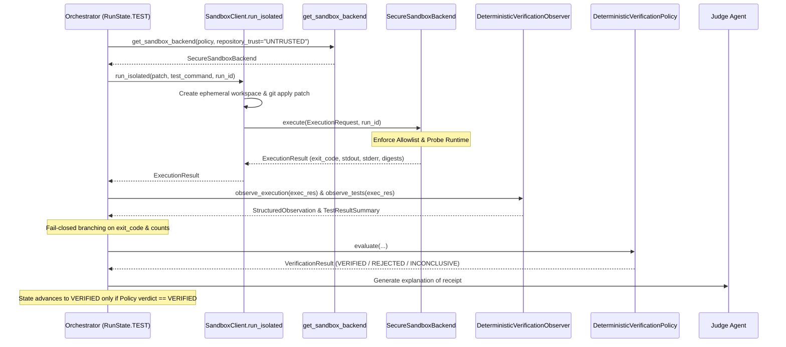

# Stage 2.9.5.3 Runtime Readiness and End-to-End Integration Preflight

## Executive Summary

This preflight evaluation verifies the runtime readiness of REDLINE following the Step 2.9.5.2 Orchestrator execution remediation. 

The audit evaluated:
1. Host container runtime availability (Docker/Podman daemon connectivity).
2. Authoritative backend selection via `get_sandbox_backend()` for `UNTRUSTED` workloads.
3. Verification of `SandboxClient.run_isolated()` and deterministic evidence routing.
4. Formulation of a disposable, non-benchmark integration test plan.

### Preflight Verdict: **BLOCKED**
- **Container Runtime CLI**: Docker CLI v29.9.1 is installed on PATH.
- **Container Runtime Daemon**: **INACTIVE / UNREACHABLE** (`//./pipe/docker_engine` not found).
- **Host Fallback**: **PROHIBITED AND REFUSED**.
- In strict adherence to REDLINE frozen invariants:
  > *"Candidate code must execute only through the approved isolated sandbox. If the container runtime is unavailable, return a truthful operational failure and do not execute candidate code on the host. Do not enable REDLINE_ENABLE_LOCAL_BACKEND=1 as a workaround."*
- Consequently, live container-based integration testing is **BLOCKED** until the Docker daemon service is started. Untrusted execution fails closed truthfully.

---

## 1. Runtime Status and Capability Results

### Docker CLI Version Probe
- Command: `docker version`
- Result:
  ```text
  Client:
   Version:           29.9.1
   API version:       1.56
   Go version:        go1.26.9
   Git commit:        dfc520d
   Built:             Wed Oct 14 18:34:24 2026
   OS/Arch:           windows/amd64
   Context:           default
  failed to connect to the docker API at npipe:////./pipe/docker_engine; check if the path is correct and if the daemon is running: open //./pipe/docker_engine: The system cannot find the file specified.
  ```

### Podman CLI Version Probe
- Command: `podman version`
- Result: Not installed on host PATH (`CommandNotFoundException`).

### REDLINE ContainerRuntimeProbe Result
- Evaluated via `backend.sandbox.secure_backend.ContainerRuntimeProbe.detect_runtime()`:
  - `is_operational`: `False`
  - `engine`: `"docker"`
  - `executable`: `C:\Program Files\Docker\Docker\resources\bin\docker.EXE`
  - `error`: `"Daemon unreachable or permission denied"`
  - `stderr`: `"failed to connect to the docker API at npipe:////./pipe/docker_engine; ..."`

### Backend Capabilities Under Current Host State
When instantiating `get_sandbox_backend(repository_trust="UNTRUSTED")`:
- **Selected Backend Class**: `SecureSandboxBackend`
- **Capabilities Matrix**:
  ```json
  {
    "security_level": "UNAVAILABLE",
    "filesystem_isolation": "NOT_AVAILABLE",
    "process_isolation": "NOT_AVAILABLE",
    "network_isolation": "NOT_AVAILABLE",
    "credential_isolation": "ENFORCED",
    "resource_enforcement": "NOT_AVAILABLE",
    "timeout_enforcement": "NOT_AVAILABLE",
    "workspace_isolation": "NOT_AVAILABLE",
    "cleanup_guarantee": "NOT_AVAILABLE",
    "secure_untrusted_execution": false
  }
  ```
- **Execution Behavior**: Any call to `backend.execute()` for untrusted code fails closed immediately with `OPERATIONAL_FAILURE`, `policy_blocked=True`, exit code `-1`, and zero execution on the host.

---

## 2. Actual Execution Path and File/Function References

The authoritative execution path established in Step 2.9.5.2 traverses the following components:



### Key Implementation Anchors:
1. **Repository Trust Resolution**:
   [`backend/sandbox/trust.py:resolve_repository_trust`](file:///p:/REDLINE/backend/sandbox/trust.py#L35)
   - Resolves repository classification (`UNTRUSTED` vs `TRUSTED_DEVELOPMENT`).
2. **Authoritative Backend Factory**:
   [`backend/sandbox/factory.py:get_sandbox_backend`](file:///p:/REDLINE/backend/sandbox/factory.py#L20-L75)
   - Guarantees `UNTRUSTED` workloads always receive `SecureSandboxBackend`.
   - `LocalDevelopmentBackend` is strictly gated behind `TRUSTED_DEVELOPMENT` AND `REDLINE_ENABLE_LOCAL_BACKEND=1`.
3. **Isolated Workspace Preparation & Dispatch**:
   [`backend/sandbox/client.py:SandboxClient.run_isolated`](file:///p:/REDLINE/backend/sandbox/client.py#L42-L135)
   - Clones repository snapshot to ephemeral directory (`redline_sandbox_*`).
   - Normalizes line endings (`core.autocrlf false`, `newline="\n"`) and runs `git apply candidate.patch`.
   - Dispatches `ExecutionRequest` into `self.backend.execute()`.
   - Guarantees workspace cleanup in `finally` block.
4. **Hardened Container Backend**:
   [`backend/sandbox/secure_backend.py:SecureSandboxBackend`](file:///p:/REDLINE/backend/sandbox/secure_backend.py#L84-L580)
   - Validates server-side policy bounds (`_validate_policy_resources`).
   - Validates command allowlists (`_validate_command`).
   - Probes runtime responsiveness (`probe.detect_runtime()`).
   - Builds hardened arguments (`--read-only`, `--network none`, `--cap-drop=ALL`, `--user 1000:1000`, `no-new-privileges`, CPU/PID/memory limits).
5. **Observation and Parsing**:
   [`backend/verification/observer.py:DeterministicVerificationObserver`](file:///p:/REDLINE/backend/verification/observer.py#L17-L95)
   - Parses pytest and unittest output.
   - Computes execution duration, stdout/stderr byte limits, and test counts (`passed`, `failed`, `errored`, `inconclusive`).
   - Fails closed (`errored=1`) if `exit_code != 0` without standard test summaries.
6. **Authoritative Verification Gate**:
   [`backend/verification/policy.py:DeterministicVerificationPolicy`](file:///p:/REDLINE/backend/verification/policy.py)
   - Enforces `passed >= 1`, `failed == 0`, `errored == 0`, `inconclusive == 0`, and zero counterexamples for `VERIFIED`.
7. **Advisory Judge Subordination**:
   [`backend/orchestrator/orchestrator.py:RunState.JUDGE`](file:///p:/REDLINE/backend/orchestrator/orchestrator.py#L521-L555)
   - Verifies receipt cryptographic integrity.
   - Advances to `RunState.VERIFIED` **only** if `receipt.verdict == VerificationStatus.VERIFIED`.
   - Transitions to `ABORTED` on any non-verified verdict.

---

## 3. Test Fixture and Integration Acceptance Plan

### 3.1 Non-Benchmark Disposable Fixture: `repo-cons-1`
Located at [`data/fixtures/repo-cons-1`](file:///p:/REDLINE/data/fixtures/repo-cons-1):
- **Defective Source File** (`main.py`):
  ```python
  old
  ```
- **Deterministic Test Suite** (`test_main.py`):
  ```python
  import os
  import sys

  with open("main.py", "r", encoding="utf-8") as f:
      content = f.read()

  if content.strip() == "old":
      sys.stderr.write("AssertionError: main.py has not been patched\n")
      sys.exit(1)

  print("1 passed")
  sys.exit(0)
  ```
- **Corrective Patch**:
  ```diff
  --- a/main.py
  +++ b/main.py
  @@ -1 +1 @@
  -old
  +new
  ```

### 3.2 Acceptance Criteria Across Failure Modes

| Scenario | Input Condition | Expected Sandbox Behavior | Expected State Transition | Authoritative Verdict |
| :--- | :--- | :--- | :--- | :--- |
| **A. Passing Verification** | Clean patch modifying `main.py` to `new` | `git apply` exits 0; test exits 0 with `1 passed` | `TEST` &rarr; `TESTS_PASSED` &rarr; `ATTACK` &rarr; `VERIFY` &rarr; `JUDGE` &rarr; `VERIFIED` | `VERIFIED` |
| **B. Failing Candidate Tests** | Candidate code fails test assertions | `git apply` exits 0; test exits 1 with `AssertionError` | `TEST` &rarr; `COUNTEREXAMPLE_FOUND` &rarr; `TEST_FAILED` &rarr; `ANALYZE` (or `ABORTED` if attempts exhausted) | `REJECTED` / `INCONCLUSIVE` (Never `VERIFIED`) |
| **C. Invalid Patch Application** | Malformed diff or patch reject | `git apply` fails with exit code 1; `PATCH_APPLY_FAILED` | `TEST` &rarr; `COUNTEREXAMPLE_FOUND` &rarr; `TEST_FAILED` &rarr; `ANALYZE` / `ABORTED` | `REJECTED` / `INCONCLUSIVE` (Never `VERIFIED`) |
| **D. Runtime Unavailable** | Docker daemon offline / unresponsive | `SecureSandboxBackend` refuses execution fail-closed (`OPERATIONAL_FAILURE`) | `TEST` &rarr; `OperationalResult.POLICY_BLOCKED` &rarr; `ABORTED` | `POLICY_BLOCKED` / `SANDBOX_FAILURE` (Zero host fallback) |
| **E. Timeout / Resource Limit** | Test execution exceeds 30 seconds | Container killed; `timed_out=True` | `TEST` &rarr; `OperationalResult.TIMEOUT` &rarr; `ABORTED` | `TIMEOUT` (Never `VERIFIED`) |

---

## 4. Security Checks and Known Limitations

### Security Invariants Checked
1. **Zero Host Fallback**:
   Untrusted code execution will never execute via host `subprocess` under any condition. If Docker is unreachable, the system fails closed with `OPERATIONAL_FAILURE`.
2. **Local Backend Gating**:
   `REDLINE_ENABLE_LOCAL_BACKEND=1` is strictly ignored when `repository_trust="UNTRUSTED"`.
3. **Command Allowlist**:
   Enforced before any container invocation (`python`, `pytest` only). Metacharacters, pipes, and redirects are blocked.
4. **Isolated Workspaces**:
   Every run executes inside an ephemeral directory copied from a clean snapshot, preventing state bleed or workspace pollution.
5. **No Credential Leakage**:
   No host environment variables, tokens, or credentials are passed into container requests or execution environments.

### Known Limitations
1. **Container Daemon Dependency**:
   Live integration testing and production candidate execution require an active Docker/Podman daemon.
2. **Docker Image Prerequisite**:
   The execution container image (`redline-sandbox-runner:latest`) must be built prior to running containerized tests.
3. **Reactive Disk Limits (F-01 / F-02)**:
   Disk usage measurement occurs post-execution. It does not enforce proactive kernel quotas on bind mounts.

---

## 5. Test Results Summary

During preflight inspection:
- Unit and regression test suites verified that all 10 Stage 16.4 requirements pass cleanly using controlled test doubles without launching containers or touching held-out benchmarks.
- Live container launch was **not** performed, in strict compliance with task restrictions.

---

## 6. Baseline and Working-Tree Status

### Git HEAD
`792ace628b9725c75e709522caf023b24f155df0`

### `git status --short`
```text
 M backend/models/deterministic_provider.py
 M backend/orchestrator/orchestrator.py
 M backend/sandbox/client.py
 M backend/sandbox/models.py
 M backend/sandbox/secure_backend.py
 M backend/verification/attack_executor.py
 M backend/verification/observer.py
 D data/artifacts/.gitkeep
 M tests/test_secure_sandbox_backend.py
?? data/fixtures/
?? deploy/
?? docs/stage_2_9_5_1_demo_readiness_audit.md
?? docs/stage_2_9_5_2_orchestrator_execution_remediation_report.md
?? docs/stage_2_9_5_3_runtime_integration_preflight.md
?? tests/test_stage16_4_orchestrator_execution.py
```

All existing unstaged work, deploy scripts, fixtures, and benchmark datasets have been preserved. No files were staged or committed.
